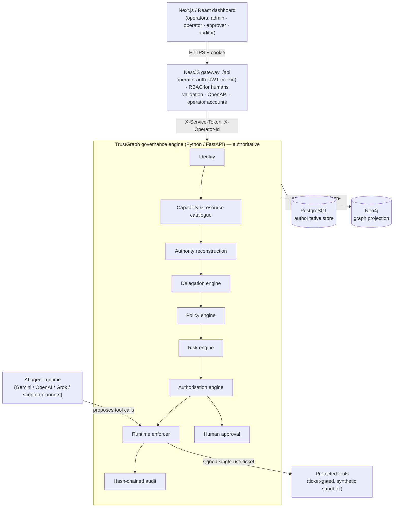
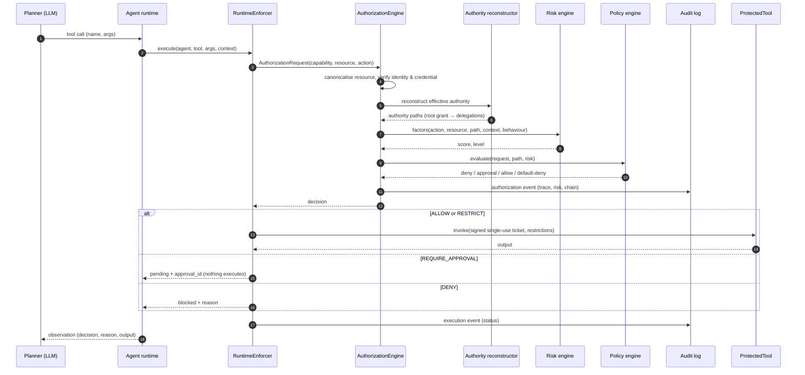
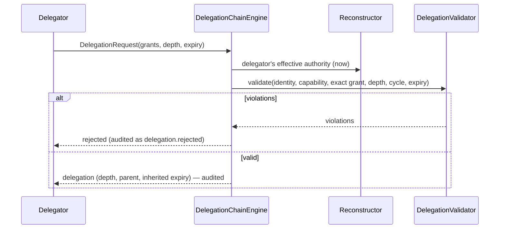
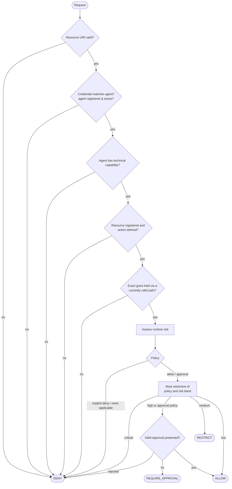
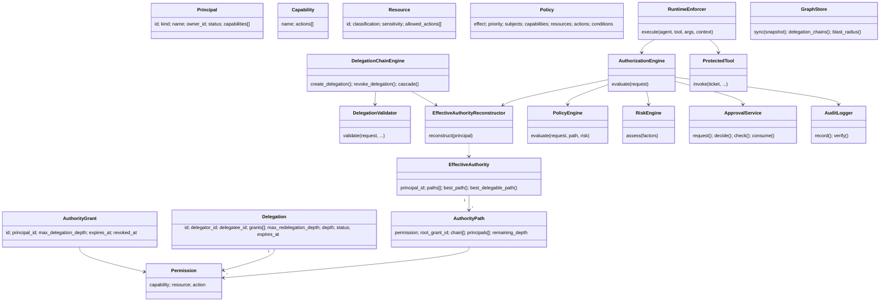
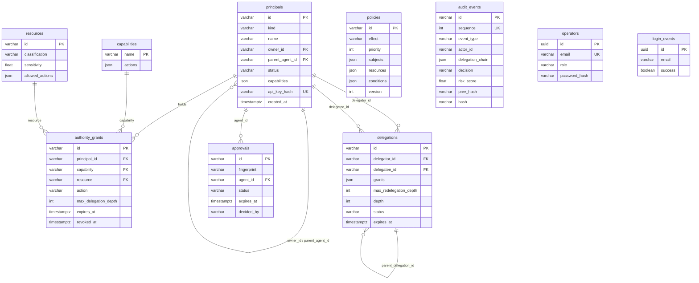
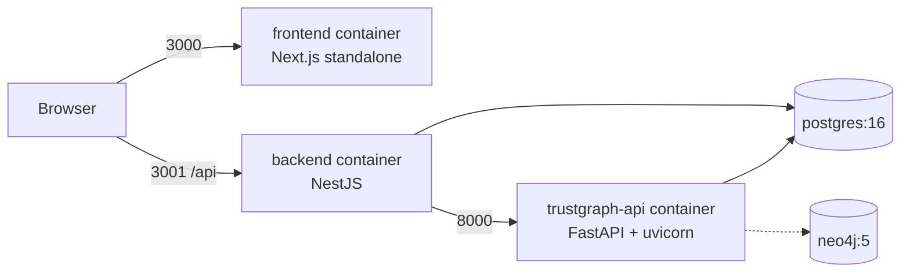

# TrustGraph AI — Architecture and Design Artefacts

This document holds the design models listed in proposal §18. Diagrams are Mermaid, so they render on GitHub and in most Markdown viewers. You can export them to images for the dissertation.

## 1. System architecture (layered)



Responsibilities:

| Layer | Owns | Never does |
|---|---|---|
| Python engine | Every authorisation decision, delegation validation, risk, approvals, audit, tool enforcement | Trust its callers for identity: agents present API keys and the gateway presents the service token |
| NestJS gateway | Human operator identity, roles, sessions, login audit, request validation, proxying | Make or alter governance decisions |
| Dashboard | Presentation, operator workflows | Hold secrets or call Python directly |
| Agent planner (LLM) | Reasoning and proposing actions | Authorise itself or hold tool implementations |
| Neo4j | Relationship and provenance queries | Act as a source of truth (it is rebuilt from PostgreSQL) |

## 2. Runtime authorisation sequence



## 3. Delegation and approval sequences



```mermaid
sequenceDiagram
    participant Ag as Agent
    participant E as Enforcer/Engine
    participant H as Human approver (dashboard)
    Ag->>E: high-risk action
    E-->>Ag: REQUIRE_APPROVAL (approval bound to SHA-256 fingerprint)
    H->>E: approve(approval_id)  — must be a human, not the requesting agent
    Ag->>E: same action + approval_id
    E->>E: full re-evaluation (authority, policy, risk)
    E-->>Ag: ALLOW (approval consumed; replay or altered arguments → new approval)
```

## 4. Authorisation decision flowchart



## 5. Class diagram (core)



## 6. Entity–relationship diagram (PostgreSQL)



`operators` and `login_events` are owned by the NestJS gateway (TypeORM migration). Every other table belongs to the Python engine (`trustgraph/persistence/tables.py`).

### Data dictionary (key fields)

| Table.field | Meaning |
|---|---|
| `principals.capabilities` | The technical capabilities (tools) an agent can drive. This is **not** authority. |
| `authority_grants.max_delegation_depth` | How many delegation hops this root authority may travel. `0` means usable but not delegable. |
| `delegations.grants` | The exact `(capability, resource, action)` tuples delegated. |
| `delegations.max_redelegation_depth` | The onward hops the delegatee may use. The effective value is `min(upstream − 1, requested)`. |
| `delegations.depth` | The position in the chain: `1` means delegated directly from the root grant holder. |
| `approvals.fingerprint` | The SHA-256 of agent, capability, resource, action, arguments and purpose. It binds the approval to one exact action. |
| `audit_events.prev_hash` / `hash` | The hash chain: `hash = sha256(prev_hash ‖ canonical_json(event))`. |
| `audit_events.principal_chain` | Root human → … → acting agent, for provenance. |

## 7. Neo4j graph model

Nodes, all labelled `:TG`: `User`, `Agent`, `Capability`, `Resource`, `AuthorityGrant`, `Delegation`.

Relationships:
- `OWNS`
- `HAS_CAPABILITY`
- `HOLDS` (principal → grant)
- `TARGETS` (grant → resource)
- `FROM` (delegator → delegation)
- `DELEGATED_TO` (delegation → delegatee)
- `GRANTS` (delegation → resource)
- `EXECUTED` / `BLOCKED` (agent → resource, from recent activity)

`FROM`/`DELEGATED_TO` edges carry `status`, so active-chain queries skip revoked or expired links:

```cypher
MATCH path = (root:User)-[:FROM|DELEGATED_TO*2..20]->(agent:Agent {id: $agent_id})
WHERE all(r IN relationships(path) WHERE r.status = 'active')
RETURN path
```

The projection is rebuilt asynchronously after every successful mutating request. Authorisation never reads from Neo4j.

## 8. Deployment



All ports bind to `127.0.0.1` in `docker-compose.yml`. Put a TLS-terminating reverse proxy in front of the stack before exposing it beyond localhost.

## 9. Module map (proposal §19 → code)

| Proposal module | Code |
|---|---|
| Identity | `trustgraph/identity/` (`models.py`, `store.py`: registration, API keys, status) |
| Capability | `trustgraph/capability/` (catalogue, resource canonicalisation) |
| Authority | `trustgraph/delegation/{provenance,authority,direct_authority,reconstructor}.py` |
| Delegation | `trustgraph/delegation/{models,engine,chain}.py` |
| Authorization | `trustgraph/authorization/engine.py` |
| Policy | `trustgraph/policy/` |
| Risk | `trustgraph/risk/` (one analyser per factor, plus `engine.py`) |
| Runtime | `trustgraph/authorization/runtime.py`, `ai_agent/runtime.py`, `ai_agent/tools/` |
| Audit | `trustgraph/audit/` |
| Graph | `graph/client.py`, `graph/store.py` |
| Approval | `trustgraph/approval/` |
| Backend | `backend/` (NestJS) |
| Frontend | `frontend/` (Next.js) |
| Baseline and evaluation | `trustgraph/baseline/rbac.py`, `evaluation/` |
